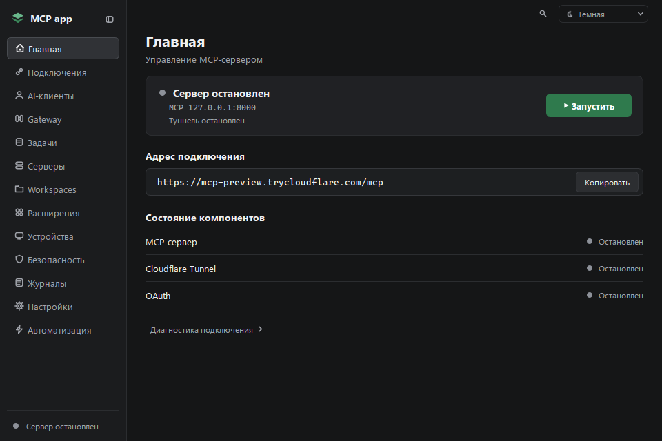
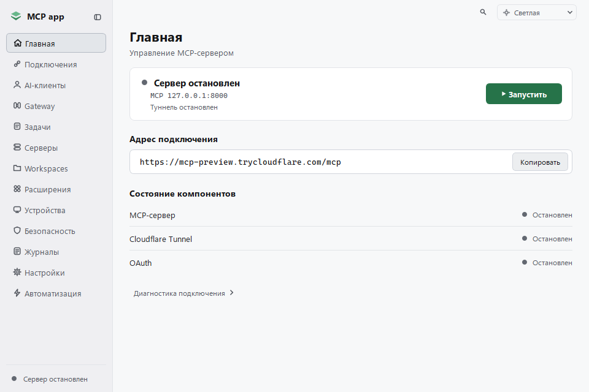

# MCP app

Десктопное приложение для Windows 10/11: одной кнопкой поднимает **MCP-сервер** (`backend/server.py`) и открывает к нему доступ через **Cloudflare Tunnel (Quick / Named)**, **ngrok Agent** или **Tailscale Funnel** (внутренний loopback сохранён для headless, локального Admin API и тестов). Работает из трея без навязчивых уведомлений и звуков, с централизованной системой постоянных журналов (`%APPDATA%\MCPApp\logs\`), автоматически перезапускает упавшие процессы и не оставляет процессов-сирот.

- **Временный адрес** `*.trycloudflare.com`: без домена и без аккаунта Cloudflare, работает сразу после установки.
- **Свой домен (Cloudflare Named)**: постоянный адрес через API Token или готовый `Cloudflare Tunnel Token` (без изменения DNS и `config.yml`, либо вручную по инструкции).
- **OAuth по умолчанию**: внешним клиентам нужен только MCP-адрес и вход по OAuth. Токен владельца (`MCP Owner Token`) — для подтверждения на странице согласия или заголовка `Authorization: Bearer ...`.

## Установка (для пользователя)

1. Скачайте [`MCPApp-Setup-1.0.0.exe`](https://github.com/SolasFor/MCP-app/releases/latest) (или [`MCPApp-1.0.0-portable.zip`](https://github.com/SolasFor/MCP-app/releases/latest)).
2. Установите приложение. Права администратора не требуются, установка выполняется в `%LOCALAPPDATA%\Programs\MCP app`.
3. Запустите **MCP app** и на странице **«Главная»** нажмите **«Запустить»**. На чистой установке сразу выбран режим «Временный адрес».
4. Скопируйте **только MCP-адрес** в блоке «Адрес подключения» и добавьте его в настройках MCP/OAuth вашего AI-клиента.

Python и `cloudflared` устанавливать отдельно не нужно — оба встроены в сборку.

**SmartScreen.** Сборка не подписана платным сертификатом издателя (Authenticode), поэтому при первом запуске Windows покажет предупреждение «Windows защитила ваш компьютер». Нажмите **«Подробнее» → «Выполнить в любом случае»**. Автоустановка обновлений (`StagedUpdater.auto_install_enabled`) отключена до появления доверенной подписи; для проверки целостности к релизу приложены `SHA256SUMS.txt` и `SBOM.cdx.json`.

## Навигация, туннели и 3 сценария доступа

- **Главная**: статус сервера и локальный порт, статус активного туннеля, кнопка **«Запустить / Остановить»**, компактное поле копирования адреса (`CopyField`), список состояний компонентов (MCP-сервер, активный транспорт, OAuth), ссылка **«Диагностика подключения ›»** и условная кнопка **«Аварийная остановка»** (при активных сервисах).
- **Подключения**: переключение 4 UI-провайдеров (**Cloudflare Quick**, **Cloudflare Named**, **ngrok Agent**, **Tailscale Funnel**) с сохранением настроек между переключениями, мастер домена, управление **MCP Owner Token** (ввод, вставка, генерация, скрытие) и настройка прокси (`none` по умолчанию / `auto` / `SOCKS5` / `HTTP CONNECT`).
- **Безопасность**: выбор **сценария доступа по умолчанию** (`Безопасный`, `Белый список`, `Полный доступ`), редактор белого списка команд Windows и SSH, переключатели **Computer Use** (`ToggleSwitch` с мгновенным автосохранением без перезапуска) и защита секретов Windows DPAPI.
- **AI-клиенты**: список зарегистрированных OAuth-клиентов, индивидуальный профиль доступа для каждого клиента в колонке **«Права»** и мгновенный отзыв токенов.

| Режим | Команды Windows | SSH | Подтверждение каждого вызова |
| --- | --- | --- | --- |
| **Безопасный** *(fail-closed)* | Нет | Нет | Не требуется: команды запрещены |
| **Белый список** *(по умолчанию)* | Только точные разрешённые команды | Только точные хосты и команды | **Нет** |
| **Полный доступ** | Произвольные команды через Windows `cmd.exe` | Произвольные команды на SSH-хостах с проверенным ключом | **Нет** |

В любом режиме у OAuth-клиента доступен диагностический `server_info` (возвращает активные `profile`, `computer_use` и `server_mode` без раскрытия секретов).
По умолчанию белый список Windows содержит `ls`, `pwd`, `dir`, `echo`, `whoami`, `ipconfig` и `systeminfo`; списки редактируются на вкладках **«Безопасность»** и **«AI-клиенты»** даже до запуска сервера. Для SSH списки хостов и команд изначально пусты.
Встроенные `dir`/`ls`/`pwd`/`echo` в режиме белого списка обрабатываются **без запуска shell**. Остальные разрешённые программы запускаются напрямую. Это список точных команд, а не разрешение на любые аргументы программы.

**Полный доступ опасен:** AI-клиент может выполнять произвольные команды с правами запущенного Windows-пользователя и учётной записи SSH. Включается только вручную после предупреждения. Windows sandbox здесь нет — доверяйте только выбранным OAuth-клиентам. Клиенты без индивидуального выбора наследуют сценарий по умолчанию со вкладки **«Безопасность»**. Смена прав применяется сразу, включая уже выданные токены.

**Токен в ссылке `?token=...` не нужен и отключён**, включая обновлённые настройки прежних версий. Для MCP-клиента с поддержкой OAuth копируйте только `https://.../mcp`. Секрет владельца используется на локальной странице подтверждения OAuth; для ручных клиентов без OAuth допустим заголовок `Authorization: Bearer ...`. Никогда не публикуйте этот токен.

Изменения сценария и прав **Computer Use** вступают в силу без перезапуска MCP-сервера (сервер уведомляет сессии через `notifications/tools/list_changed`, хотя некоторым AI-клиентам нужно обновить кэш инструментов).
При смене токена владельца перезапускается только MCP-сервер (туннель сохраняется), старые OAuth-токены отзываются, а DCR-регистрация сохраняется для повторного подключения.
На новом адресе Quick Tunnel клиенты переавторизуются заново с наследованием выбранного сценария по умолчанию.

Подробнее: [дизайн-система DESIGN.md](DESIGN.md), [модель угроз v1.0.0](docs/threat-model-v1.md),
[матрица совместимости](docs/compatibility-matrix.md),
[руководство по обновлению с v0.8.5](docs/upgrade-guide.md),
[справочник инструментов](docs/tool-reference.md),
[журнал изменений (CHANGELOG)](CHANGELOG.md),
[релиз v1.0.0](docs/releases/v1.0.0.md),
[автоматизация, мониторинг и Playground v0.9.9](docs/automation-monitoring.md),
[удалённое управление SSH/SFTP v0.9.8](docs/remote-management.md),
[расширения и SDK v0.9.7](docs/extensions.md),
[Computer Use v0.9.6](docs/computer-use.md),
[рабочие пространства v0.9.5](docs/workspaces.md),
[менеджер серверов v0.9.4](docs/server-manager.md),
[диспетчер задач v0.9.3](docs/task-manager.md),
[универсальный MCP Gateway v0.9.2](docs/mcp-gateway.md),
[менеджер подключений и 4 UI-транспорта](docs/connection-manager.md),
[свой домен Cloudflare Named](docs/custom-domain.md),
[система прокси](docs/proxy.md),
[постоянное логирование и диагностический ZIP](docs/logging.md),
[архитектура UI-темы v0.9.0](docs/ui-design-system.md),
[сценарии Windows/SSH](docs/oauth-fixed-windows-ssh.md),
[стабильность и безопасность v0.8.6](docs/stability-security.md),
[OAuth через Cloudflare](docs/oauth-quick-tunnel.md),
[защищённое хранение клиентов](docs/oauth-persistence.md),
[журнал выполнения Windows/SSH и диагностика Cloudflare](docs/oauth-execution-audit.md),
[сторонние лицензии](docs/third-party-licenses.md).

## Интерфейс (`v1.0.0`)

- **Minimalist Compact Desktop UI ([DESIGN.md](DESIGN.md))**: сдержанная графитовая эстетика **Linear / Raycast / Docker Desktop** (`#151617` в Dark и `#F7F8F9` в Light), зелёный акцент строго для состояния и запуска сервера, плоские секции с `1 px` разделителями вместо лишних карточек и адаптивные панели действий (`FlowLayout`).
- **Компактная геометрия**: окно по умолчанию `960×640` (минимум `800×540`), сворачиваемая боковая панель `184 px` / `52 px` (`Ctrl+B`), палитра команд (`Ctrl+K`), быстрая навигация (`Ctrl+1..9`), только функциональный переход `ToggleSwitch` (`150 ms`, отключается при выключенных анимациях Windows), проверка HiDPI `100–200%` (включая `175%`).
- **13 активных разделов**: **Главная**, **Подключения**, **AI-клиенты**, **Gateway**, **Задачи**, **Серверы**, **Workspaces**, **Расширения**, **Устройства**, **Безопасность**, **Журналы**, **Настройки**, **Автоматизация**.
- **Dark / Light / System** темы и живое переключение языка **RU / EN** без перезапуска с сохранением геометрии окна; бесшумные диалоги `SilentDialog` / `SilentMessageBox` и wheel-безопасный `SafeComboBox`.
- Headless-запуск сервера без GUI: `python main.py --headless` / `MCPApp.exe --headless`.

## FAQ и известные ограничения (`v1.0.0`)

- **Является ли «Полный доступ» или отдельное расширение песочницей?** Нет. В режиме `full` команды выполняются с правами текущего пользователя Windows; сторонние расширения работают в отдельном процессе, а не в OS sandbox. Подробнее: [модель угроз v1.0.0](docs/threat-model-v1.md).
- **Поддерживает ли временный адрес `*.trycloudflare.com` SSE?** Нет, Quick Tunnel работает только в JSON-режиме (`MCP_JSON_RESPONSE=1`).
- **Почему автоустановка обновлений выключена?** Сборки не подписаны доверенным Authenticode-сертификатом; `StagedUpdater.auto_install_enabled = False`. Подробнее: [v1.0.0 release notes](docs/releases/v1.0.0.md).
- **Переносятся ли DPAPI-секреты на другой ПК?** Нет, секреты Windows DPAPI привязаны к пользователю и машине; резервные копии настроек исключают секреты по умолчанию ([upgrade guide](docs/upgrade-guide.md)).




## Данные

| Что | Где |
|---|---|
| Настройки | `%APPDATA%\MCPApp\settings.json` |
| Токен (доступ только у вашего пользователя) | `%APPDATA%\MCPApp\token.json` |
| Клиенты и права OAuth (зашифровано DPAPI) | `%APPDATA%\MCPApp\oauth\state.sqlite3` |
| Постоянные журналы и архивы компонентов | `%APPDATA%\MCPApp\logs\` |
| Рабочая папка и журнал сервера | `%APPDATA%\MCPApp\server\mcp_audit.log` |
| Журнал выполнений OAuth Windows/SSH (JSONL, с ротацией, без открытого текста команд) | `%APPDATA%\MCPApp\server\mcp_execution_audit.jsonl` |
| Отчёт о сбое | `%APPDATA%\MCPApp\crash.log` |

При удалении эти данные остаются. Данные прежней версии (`%APPDATA%\SouronMCP`) копируются при первом запуске, поэтому токен и клиенты сохраняются.

## Запуск из исходников

```powershell
python -m venv .venv
.venv\Scripts\activate
pip install -r requirements.txt
python main.py
```

Здесь нужен установленный cloudflared: `winget install --id Cloudflare.cloudflared`.

## Сборка .exe и установщика

```powershell
powershell -ExecutionPolicy Bypass -File packaging\build.ps1
```

Скрипт сам:
1. создаёт окружение `.venv-build` и ставит зависимости (из `requirements.lock`, если он есть);
2. скачивает последний `cloudflared.exe` и проверяет подпись Cloudflare;
3. рисует иконку и ресурс версии;
4. собирает `dist\MCPApp\MCPApp.exe` через PyInstaller (onedir, без консоли);
5. запускает самопроверку собранного exe (`MCPApp.exe --selftest`);
6. упаковывает portable zip и, если установлен Inno Setup 6, `MCPApp-Setup-<версия>.exe`.

Для установщика нужен Inno Setup: `winget install --id JRSoftware.InnoSetup`. Другой Python для сборки выбирается так: `-Python "py -3.13"`.

**Зафиксированные зависимости.** Воспроизводимая сборка использует `requirements.lock`, `requirements-build.txt` и проверенный по SHA-256 + Authenticode `packaging/cloudflared.json`. Проверка лицензий, Ruff/mypy, `pip-audit` и CycloneDX SBOM (`SBOM.cdx.json`) выполняются в CI.

**CI.** Проверки MCP, безопасности и сборки находятся в `.github/workflows/transport-checks.yml`, `.github/workflows/rc-windows.yml` и едином gated-workflow `.github/workflows/build.yml`.

## Структура

```
main.py                 точка входа: GUI / --backend / --headless / --selftest
DESIGN.md               спецификация дизайн-системы и дизайн-токенов
app/gui.py              QApplication, трей, один экземпляр, перенос данных
app/core/               ServiceManager, процессы, health-check, токен, прокси, логирование
app/ui/                 Minimalist Graphite дизайн-система, Dark/Light/System, RU/EN, 13 страниц и диалоги
backend/server.py       MCP-сервер (uvicorn + MCP SDK), OAuth, Gateway, Tasks, Extensions, Remote, Automation
packaging/              PyInstaller spec, build.ps1, installer.iss, CI
```
