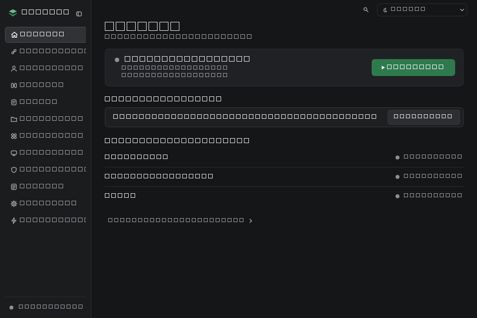
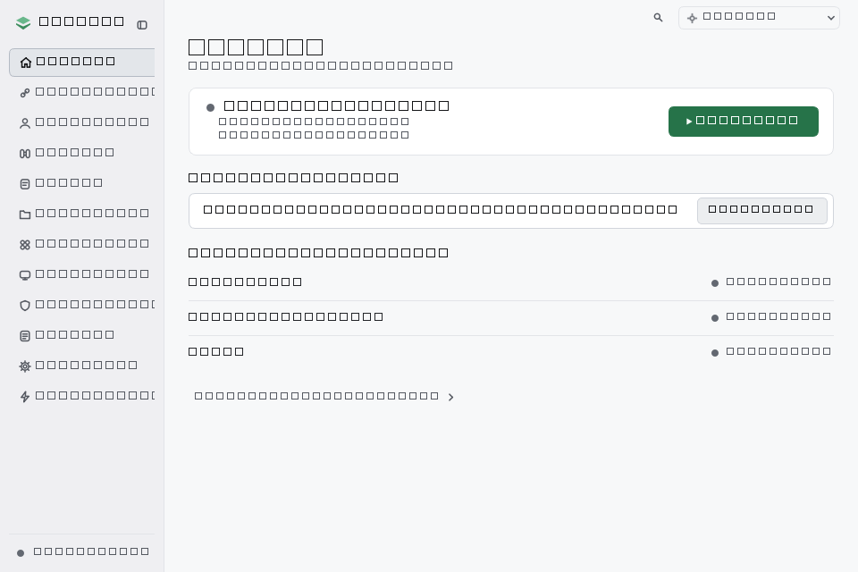
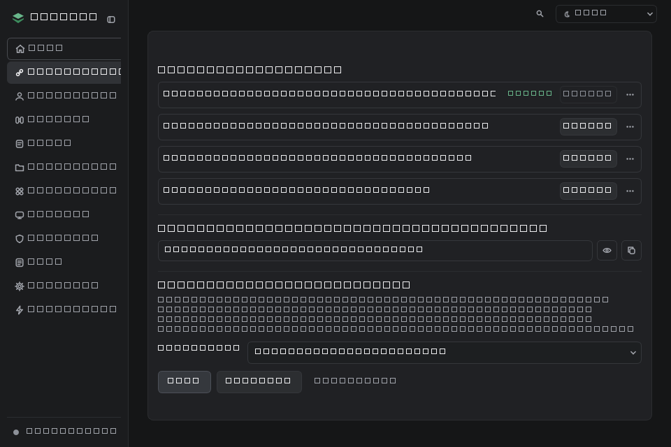
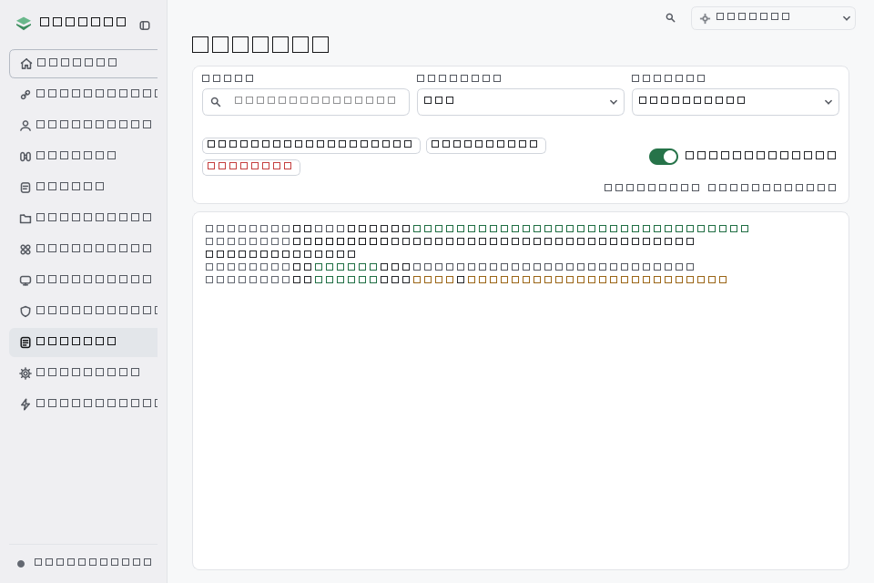
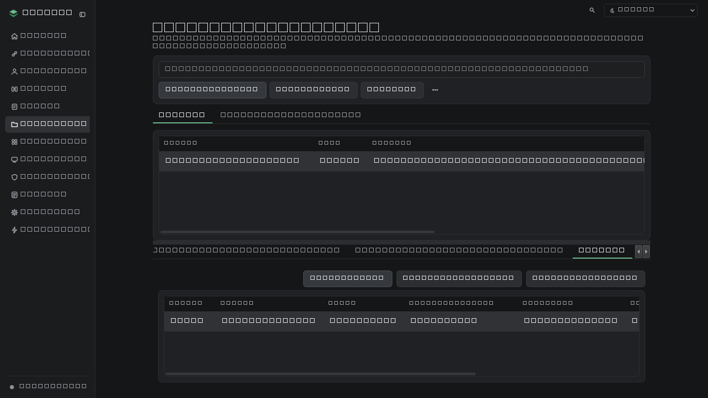
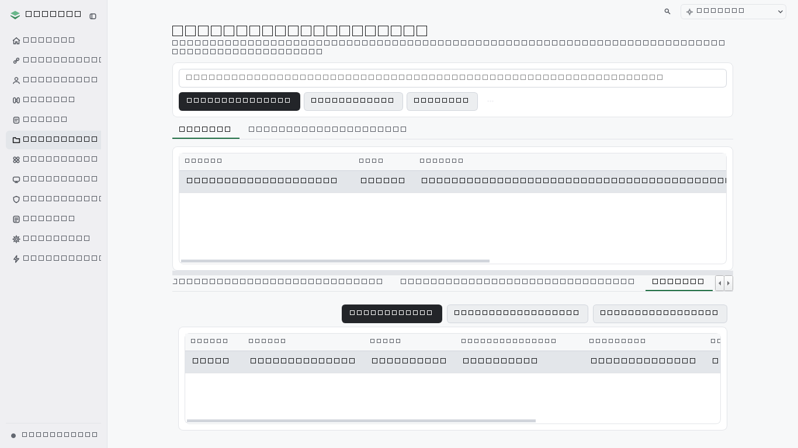

# MCP-app UI Design System (`v0.9.0`)

Редизайн интерфейса вдохновлён компактной навигацией, типографикой и сдержанными акцентами **Linear** в сочетании с функциональными таблицами, карточками сервисов и журналом событий **Docker Desktop**. Используются собственные векторные иконки (`QPainter` в `app/ui/icons.py`), без заимствования товарных знаков или сторонних ассетов.

## Палитра и контраст (WCAG AA ≥ 4.5:1)

| Токен | Dark | Light | Назначение |
| --- | --- | --- | --- |
| `bg` | `#14151A` | `#F8F9FC` | Основной холст окна и topbar |
| `sidebar` / `surface` | `#191A21` | `#FFFFFF` | Боковая панель и карточки |
| `elevated` | `#20222B` | `#FFFFFF` | Hero-карточка Engine и всплывающие меню |
| `input` | `#111217` | `#FFFFFF` | Поля ввода, лог-вьюер и сегмент-группы |
| `hairline` | `#272832` | `#E2E4E9` | Разделители и тонкие границы `1 px` |
| `accent` | `#818CF8` | `#635BDE` | Фокус полей, ссылки, активные иконки |
| `accent_strong` | `#5B5EE6` | `#635BDE` | Заливка Primary-кнопок (контраст с `#FFFFFF` ≥ 5.0:1) |
| `text_strong` | `#F4F4F5` | `#18181B` | Заголовки и ключевые подписи |
| `text_muted` | `#A1A1AA` | `#52525B` | Вторичный текст и подзаголовки |
| `text_faint` | `#8E909E` | `#646975` | Подписи полей и метки времени |

Поддержаны режимы **Тёмная**, **Светлая** и **Системная** (автоопределение темы Windows `AppsUseLightTheme` и `QStyleHints.colorScheme()`), переключение выполняется мгновенно без перезапуска.

## Типографика, радиусы и архитектура

- **Шрифты**: `Segoe UI Variable Text`, `Segoe UI`, `Inter` (интерфейс); `Cascadia Mono`, `JetBrains Mono`, `Consolas` (URL, команды, токены, журнал).
- **Скругления**: `6–10 px` (`Badge` / кнопки `7 px`, карточки и диалоги `10 px`).
- **Модули**:
  - `app/ui/tokens.py` — замороженные наборы токенов и расчёт контраста WCAG 2.1.
  - `app/ui/theme.py` — `ThemeManager`, генерация `@1x/@2x` SVG/QPainter переключателей и QSS.
  - `app/ui/i18n.py` — живая локализация **RU / EN** с контролем паритета ключей.
  - `app/ui/components/` — `Sidebar`, `CommandPaletteDialog`, `DataTable`, `LogViewerWidget`, `ToastManager`, `Card`, `Badge`, `EmptyState`, `ErrorBanner`.
  - `app/ui/pages/` — модульные страницы **12 основных разделов** (`HomePage`, `ConnectionsPage`, `ClientsPage`, `GatewayPage`, `TasksPage`, единый `WorkspacesPage` с привязанными/непривязанными серверами, `ExtensionsPage`, `DevicesPage`, `SecurityPage`, `LogsPage`, `SettingsPage`, `AutomationPage`).

## Горячие клавиши и доступность

- `Ctrl+K` — Command Palette (быстрый поиск страниц, включая переход в Workspaces по запросам `"servers"`/`"серверы"`, переключение темы/языка, запуск/остановка Engine).
- `Ctrl+B` — свернуть/развернуть боковую панель.
- `Ctrl+1` … `Ctrl+9` — переход по активным разделам (`Главная`, `Подключения`, `AI-клиенты`, `Gateway`, `Задачи`, `Workspaces`, `Расширения`, `Безопасность`, `Журналы`).
- `Ctrl+Q` — выход из приложения.
- Настройки темы, языка, ширины боковой панели и геометрии окна сохраняются в `%APPDATA%\MCPApp\settings.json`; на Windows настроено `PassThrough` HiDPI-масштабирование (проверено при `100%`, `125%`, `150%`, `200%`).

## Скриншоты (Windows 11)

